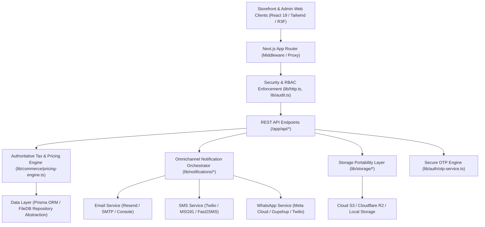

# Queens Care Laboratories — System Architecture & Design Specification

## 1. System Overview

Queens Care Laboratories is a clinical-luxury pharmaceutical and healthcare e-commerce platform built with Next.js 16 (Turbopack, App Router, React 19) and TypeScript.

The architecture is strictly separated into modular, hosting-agnostic layers:

---

## 2. Core Subsystems

### 2.1 Authoritative Pricing & GST Engine (`lib/commerce/pricing-engine.ts`)
- **Server Authoritative**: Client-supplied prices, taxes, and shipping rates are never trusted. All calculations are executed server-side based on HSN/SAC codes and tax nexus rules.
- **Intra-State vs. Inter-State Dual Nexus**:
  - Intra-State (Origin State = Maharashtra): 50% CGST + 50% SGST.
  - Inter-State (Origin State $\ne$ Destination State): 100% IGST.
- **Immutable Invoice Snapshots**: Every finalized order freezes an immutable tax and company detail snapshot (`invoice_snapshot_{order.id}`). Subsequent changes to company GSTIN or tax rules never retroactively alter historical invoices.

### 2.2 Omnichannel Notification Orchestrator (`lib/notifications/notification-orchestrator.ts`)
- Decouples lifecycle business logic from communication protocols.
- Routes events (`order_placed`, `order_confirmed`, `order_dispatched`, `order_delivered`, `order_cancelled`, `order_refunded`, `prescription_approved`, `prescription_rejected`) across:
  - **Email**: 13 branded HTML/Text responsive templates via Resend or SMTP.
  - **SMS**: Pluggable providers (Twilio, MSG91, Fast2SMS, Generic Webhooks).
  - **WhatsApp**: Pluggable providers (Meta Cloud API, Gupshup, Twilio).
  - **Web Push**: VAPID standard browser push notifications.
- **Duplicate Send Protection**: Enforces composite idempotency keys (`order_placed_{id}`, `status_{id}_{status}`) to ensure network retries never trigger duplicate patient notifications.

### 2.3 Secure OTP Engine (`lib/auth/otp-service.ts`)
- Cryptographically secure 6-digit numeric OTP generation (`crypto.randomInt`).
- Salted `scrypt` hashing before persistence (raw OTP is never stored).
- Timing-safe hash comparison (`crypto.timingSafeEqual`) preventing timing attacks.
- Configurable rate-limiting, resend cooldown (60s), expiry (5m), and brute-force lockout (5 attempts).

### 2.4 Storage Portability Layer (`lib/storage/storage-provider.ts`)
- Decouples file uploads from server filesystem.
- Seamlessly switches between local filesystem (`public/uploads`) and S3-compatible cloud storage (AWS S3, Cloudflare R2, MinIO, Supabase) via standard environment variables (`STORAGE_PROVIDER=s3_compatible`).

---

## 3. Role-Based Access Control (RBAC) & Security Hardening

| Role | Access Scope | Enforced By |
|---|---|---|
| **Anonymous / Customer** | Storefront, personal cart, own account orders, saved addresses, own prescription uploads. | Session JWT (`userId` comparison), IDOR verification. |
| **Employee** | Operations Portal, Order fulfillment desk, Duty Pharmacist review desk, Inventory adjuster. | `requireUser(["admin", "employee"])` |
| **Admin** | Full system control: staff accounts, integrations, pricing, billing, audit logs, CMS. | `requireUser(["admin"])` |

- **Security Headers**: HSTS (`max-age=31536000`), `X-Frame-Options: SAMEORIGIN`, `X-Content-Type-Options: nosniff`, Content Security Policy (CSP) permitting Razorpay & Cashfree checkout modals.
- **Access Audit Trail**: Structured event logging for all staff creations, role elevations, customer disablement, and prescription decisions with actor metadata, IP, user-agent, and before/after diffs.
